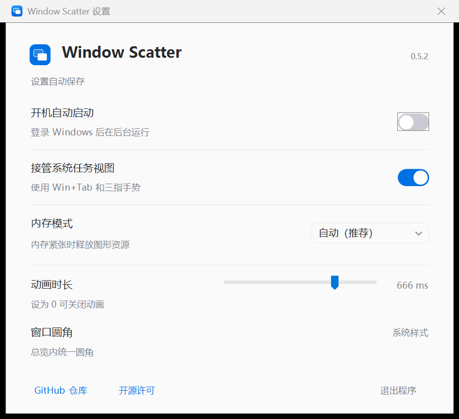

# Window Scatter

为 Windows 11 提供类似 macOS Exposé 的窗口总览。

**独立版 0.5.5**：下载一个 EXE 即可运行，无需 Windhawk、.NET 或额外运行库。原有 **Windhawk 模组 0.4.10** 继续保留。

## 独立版

[下载 WindowScatter.exe](https://github.com/SinCircle/windhawk-window-scatter/releases/latest/download/WindowScatter.exe) · [Release 与校验值](https://github.com/SinCircle/windhawk-window-scatter/releases/latest)

1. 将 EXE 放在准备长期使用的位置。若已启用 Windhawk 中的 Window Scatter，请先停用该模组。
2. 第一次双击后在后台运行，不弹窗口，也不添加托盘图标。
3. 运行期间再次双击，打开单页设置面板。开机启动、系统触发、内存模式和动画都在同一页，修改自动保存。
4. 关闭面板后继续运行；点击面板底部的“退出程序”停止运行并恢复系统入口。

独立版默认动画 **666 ms**，开机启动默认关闭。面板跟随系统浅色、深色与高对比度设置；正常运行时不显示状态提示，异常时才显示说明和重新连接按钮。控件使用 Win32 与 GDI+，保留键盘操作和原生下拉列表，没有 WebView 或浏览器运行时。



面向 **Windows 11 x64**。单文件是分发形式：运行时会将内置系统连接组件释放到本地应用数据目录，并自动管理。当前已验证系统可离线启动；其他 Windows 版本首次适配时可能从微软符号服务器下载匹配文件，之后使用本地缓存。接口不兼容时会在设置中提示，不接管系统任务视图。

设置保存在当前用户的 `HKCU\Software\SinCircle\WindowScatter`；运行组件与符号缓存位于 `%LOCALAPPDATA%\WindowScatter`。开机启动仅注册当前用户的启动项；启用后若移动 EXE，请在新位置关闭并重新开启该选项。

也支持 `WindowScatter.exe --settings` 直接打开设置，以及 `WindowScatter.exe --exit` 退出。独立版与 Windhawk 版不能同时接管系统入口，程序会检测并提示冲突。

0.5.0 已在 Windows 11 x64、内部版本 26200.9457 上实际连接 Explorer，并由用户确认 Win+Tab、三指短上滑与持续选窗后松手切换正常。其他 Windows 版本尚未逐一验证。

## 功能

- 按 **Win+Tab** 打开或关闭总览，松开按键后保持打开；点击窗口切换，按 Esc 或点击背景取消。
- **三指短上滑**打开总览，松手后保持；上滑后不松手，继续按窗口实际位置向上下、左右或斜向移动，松手进入选中的窗口。总览中三指下滑退出。
- Win+Tab 和触摸板手势通过 Explorer 的系统任务视图入口接管，不安装全局键盘钩子。触摸板需使用系统的任务视图手势配置。
- **Shift+Win+Tab** 打开系统任务视图。保留独立后台渲染进程，不显示托盘图标。
- 窗口按实际比例排列，使用实时画面、系统合成器圆角、标题和非线性动画。
- 已最小化的窗口固定在各显示器底部中央，使用独立排列的较小预览；点击或三指选择后恢复并切换。
- 选中框跟随 Windows 系统主题色，沿预览和下方标题的整体外缘连续绘制，保留 4 DIP 的透明间距。
- 悬停预览显示关闭按钮，其左侧为最小化按钮。最小化后总览保持打开，窗口移入下方一排；已最小化或不支持最小化的窗口仅显示关闭按钮。关闭时请求应用正常关闭，应用仍可显示保存确认；窗口关闭后，其余预览重新排列。
- DirectComposition 执行动画，显示器刷新率由 DWM 驱动；任务栏保持可见。
- 独立版默认动画时长 666 ms，Windhawk 版默认 320 ms；均可调整时长；总览内统一使用 8 DIP 的系统样式圆角。
- 支持自动、常驻和省内存三种模式，默认自动。

## 0.5.5 性能优化 / 模组 0.4.10

- 大量窗口的候选布局复用真实方位权重，用评分上界提前排除不可能胜出的候选；删除已经被更长路径蕴含的冗余间距约束。保留自由坐标、窗口面积权重、统一缩放与运动分离规则，小场景的独立参考坐标保持一致。
- 文字、宽度、DPI 与连接圆角未变时复用标题表面和图层；同 DPI 的字体格式复用。500 条连续位置通知按最终真实尺寸合并处理，不增加轮询或延迟定时器。
- 每个显示器复用壁纸表面；缓存命中时仅检查文件时间戳，不重复枚举系统壁纸。显示器、设置与主题通知使缓存失效。窗口层次使用索引更新，顺序未变时不重建图层树。
- 未选中的窗口不创建选框和按钮相关的五个合成对象，也不提交它们的动画。动画中首次悬停时，装饰加入原来的绝对时间轴。相同动画的查询改为索引，避免大场景逐条扫描。
- 后台仍采用事件等待，动画仍一次性提交给 DWM。关闭总览会解除窗口事件钩子；60 秒后一次性回收壁纸缓存并关闭任务栏读取线程，保留排序快照供下次直接使用，再异步刷新。不存在常态逐帧回调。自动模式保留设备以便快速展开，省内存模式释放设备并回收工作集。

在同一台 Windows 11 机器上交替运行三次，纯几何基准的中位数如下。多屏场景是确定性几何模型，窗口总数平均分配到各屏；这些时间不含原生窗口枚举、DWM 画面绑定和首次显示，也不代表屏幕帧率。

| 总窗口数 / 显示器数 | 0.5.4 首次布局 | 优化后首次布局 | 0.5.4 新增窗口 | 优化后新增窗口 |
| --- | ---: | ---: | ---: | ---: |
| 128 / 1 | 44.94 ms | 19.27 ms | 30.67 ms | 21.10 ms |
| 256 / 1 | 277.85 ms | 55.86 ms | 241.72 ms | 72.64 ms |
| 512 / 1 | 1425.74 ms | 220.93 ms | 1242.22 ms | 171.51 ms |
| 512 / 2 | 577.28 ms | 109.81 ms | 1648.95 ms | 160.08 ms |
| 512 / 4 | 212.45 ms | 55.79 ms | 384.85 ms | 87.45 ms |

128 个隐藏虚构源窗口的资源基准中，重复标题准备约从 20–30 ms 降至 0.05 ms，双屏壁纸缓存查询约从 8–10 ms 降至 0.1 ms。原生画面绑定仍是首次准备的重要开销。实际 240 Hz AMD 内屏与 160 Hz NVIDIA 外屏已做 128 个虚构窗口的合成检查，但抓屏采样会引入额外跨显卡复制，目前不据此声称 FPS 提升。

自动模式经过 60 秒缓存回收，再采样 20 秒，进程 CPU 时间增量为 0 ms、I/O 为 0、没有待触发的定时器；这表示测量区间内近零后台活动，不表示进程或保留设备不占内存。省内存模式已验证释放图形设备。布局回归新增 64–512 个窗口、等价评分与约束蕴含检查，原生回归检查标签复用、首次悬停和通知合并。

可复测：`test-performance.ps1 -Mode layout`（默认，纯几何）、`-Mode resources`（隐藏虚构窗口，资源准备）、`-Mode idle`（包含任务栏读取器，约 85 秒）。均支持 `-Compiler` 指定 LLVM-MinGW 和 `-Architecture i686`；功能回归仍使用 `test-layout.ps1` 与 `test-minimized.ps1`。

## 0.5.4 / 模组 0.4.9 更新

- 普通窗口和最小化窗口的文字标签统一进入、退出时长，取此前普通时长与快速时长的平均值：`(窗口动画时长 + min(120 ms, 窗口动画时长 × 28%)) / 2`。中途反向时从实际透明度接续；窗口本身的运动时长不变。
- 首次展开先取得能放进当前屏幕的统一缩放比例，再独立求解每个窗口的横纵坐标。位置偏移按窗口面积加权，大窗更优先靠近真实中心，小窗承担更多避让；窗口和标签必须留在可用区域内，并保持间距与明显的原始方位关系。最终坐标不受行列归属或组内居中限制。
- 求解器只对发生冲突的窗口尝试避让方向，再做带边界与间距约束的加权位置投影。搜索次数有固定上限，随窗口数量增加而收紧；初始紧凑排布也作为求解预算不足时的可用退路。全部计算只在场景改变时执行，不参与逐帧渲染。
- 相同位置和尺寸的窗口先排除重复置换，把搜索预算用于不同的几何形状；五至八个窗口使用更高的有限预算，减少三大三小等混合场景沿用初始堆叠的情况。此处只消除可互换窗口的重复编号，不增加对齐或行列约束。
- 增删窗口时参考上一轮坐标，保持已有预览的分离运动路径；关闭窗口后降低旧坐标的权重，让邻居收拢补位，不保存固定行列。真实窗口被移动后，按最新桌面位置重新计算，缓存不能覆盖真实位置。相同场景重复展开不重排；显示器工作区或 DPI 变化时重新布局。
- 最大化等覆盖整个布局区域的窗口只保留历史避让方向，不继承旧预览的位置偏移。窗口减少后，单个大窗恢复横向居中，上下排列的大窗横向对齐，左右排列的大窗纵向对齐；面积权重保持不变。
- 区分总览内的连续重排与从桌面重新展开：总览内保留已有预览的避让路径；关闭期间桌面场景发生变化后，重新展开会释放旧避让关系，按当前真实位置求解。未变化的场景仍精确复用原坐标。
- 总览打开期间，系统显示、隐藏、移动、缩放和最小化事件会更新相应预览。布局更新从当前动画位置接续，无逐帧轮询。
- 底部最小化窗口按任务栏应用顺序排列，同一应用相邻；应用内保留原有顺序。优先用窗口 AppUserModelID 识别分组，普通桌面应用回退到程序路径。
- 任务栏顺序由独立后台线程按需读取，并在启动时预取。展开直接使用缓存，读取完成后仅在顺序变化时调整；任务栏信息不可用时保留应用分组和稳定顺序。没有周期扫描，省内存或低内存回收时也释放该读取器。

布局回归覆盖面积加权的独立数值参考解、80 组固定的新增/移除/尺寸变化、连续增删、实际位置变化、普通屏/宽屏/竖屏，以及最多 40 个窗口的负坐标显示器场景；检查统一比例、标题间距、重复展开稳定性和运动中的相交。`test-layout.ps1 -Taskbar` 可单独检查本机任务栏窗口映射。任务栏使用 Windows 11 提供的辅助功能按钮标识，未来系统变更可能使排序回退。

## 0.5.3 / 模组 0.4.8 更新

- 在关闭按钮左侧加入同样大小的圆形最小化按钮，提供独立悬停反馈。两个按钮共用原有合成器图层，按钮图像按显示器缓存。
- 点击后向应用发送原生最小化请求，收到状态变化后再把预览连续移到底部，总览保持打开；应用未执行请求时保留原布局。
- 拖出按钮或从一个按钮拖到另一个按钮后松开会取消操作。已经最小化的窗口不显示最小化按钮，恢复后重新显示。

## 0.5.2 / 模组 0.4.7 更新

- 将当前桌面中已最小化的窗口纳入总览。使用保存的还原位置和 DWM 保留画面，避免采用任务栏图标或屏外坐标。
- 最小化预览固定在底部中央，保持原有颜色和透明度。预览保持单行，高度上限 90 DIP、宽度上限 160 DIP；拥挤时先缩小间距，再统一缩小预览，不增加行数。连同标题最多占用 116 DIP 高度，底部仅留足以容纳选中框的小间距，把更多高度让给中央主区域。
- 通过已有合成器动画从屏幕下方滑入，离场时滑回屏幕外，仅使用 94%–100% 的轻微缩放；展开、收回或再次展开均从当前画面接续，不先复位。不增加截图或逐帧 CPU 绘制。
- 没有可用 DWM 画面的窗口使用一张共享的 160×100 占位图，仍显示真实标题并支持选择恢复。
- 标题以居中的浅色标签贴住预览底边，上沿两侧通过相切圆弧平滑连接，下沿保留圆角，使用深色文字，并在前面显示应用提供的窗口图标；没有可用图标时保留文字。图标每次总览仅读取一次，与文字绘制在已有标签表面，排列变化时复用。
- 调整独立 EXE 图标中两个窗口的尺寸和位置，使图案居中；设置面板同步使用相同图形比例。
- 取消总览不会恢复最小化窗口。点击或三指选中后仅恢复该窗口，并保留最小化前的最大化状态。
- 选中的最小化预览直接从卡片位置放大到窗口还原位置；只有未选中的最小化预览向屏幕下方滑出，避免还原前先缩回造成的跳变。
- 还原期间通过该窗口的位置事件校准到 DWM 实际可见边界，并在源画面转为实时窗口时重新绑定完整取样区域，保留已有动画变换。仅在窗口事件发生时调整动画，不做逐帧轮询或截图。还原过程中再次展开会按真实最小化状态重新分区，已恢复的窗口从当前画面连续移回主区域；延迟完成的还原由系统事件同步。

32/64 位专项测试覆盖窗口筛选、底部居中与主区域避让、完整边缘与原始颜色、动画中途反向、图标绘制与复用、鼠标/空间选择、取消与恢复、实际还原边界、主体像素交接和图形设备引用释放。原有手势操作另有回归检查；圆角抗锯齿边缘不作为主体像素相同的断言。

## 0.5.1 / 模组 0.4.6 更新

- 复用已有 DirectComposition 矩形裁切对象的原生圆角属性，统一裁出 8 DIP 圆角，覆盖最大化和贴靠窗口，去掉圆角范围外的 DWM 阴影残留。应用内容自身绘制的内部阴影不做图像处理。
- 删除每窗口 4 个仿射效果和 4 个复合效果以及共享圆角模板；不增加截图、轮询或逐帧绘制。八个半径属性复用同一个合成器动画；这不是严格的零 GPU 开销，实际帧耗时尚未单独测量。
- 选中框使用相同圆弧和透明间距，保留源窗口的内容透明度。
- 不再提供额外圆角大小设置。原有手势、动画时长和内存模式保持不变。

本次更新通过了 32/64 位编译、普通/小圆角/直角/半透明窗口的隔离渲染检查，以及独立 EXE 的自检、连接和设置面板检查；本机模组实测确认展开、收回和三指选窗流畅，圆角与阴影正常。复用图形设备连续创建、关闭 60 次场景，预热后的私有内存增长约 0.89 MiB。反复销毁重建图形设备的 64 位压力测试仍有私有内存波动，尚不能据此认定所有内存保留问题已解决。

## 0.4.5 更新

- 移除 Ctrl+Alt+Space 备用快捷键的注册和消息处理，不再占用此组合键。
- Win+Tab、三指手势、Shift+Win+Tab 和后台内存策略维持原有行为。

## 0.4.4 更新

- 使用系统原生请求接管 Win+Tab 和触摸板任务视图，移除全局键盘捕获与定期钩子续期。
- 支持三指连续空间选择，并区分短上滑与继续选窗：短滑松手保持总览，继续移动选窗后松手切换。选中框跟随手势，不移动系统鼠标指针。
- 去除打开总览时的上滑位移对选窗的影响，支持八个方向、负坐标显示器布局、连续手势消息合并及过期消息丢弃。
- 修复系统强调色选中框变黑的问题，使用 UISettings 读取颜色并接收变色通知；加入预览关闭按钮及关闭后的布局更新。
- 保留独立后台渲染进程和原有三种内存模式。

本版本已通过 32/64 位编译、隐藏合成器探测、系统请求桥接和完整手势生命周期测试；覆盖短滑保持、八方向选择、松手切换、取消、旧消息拒绝及忙碌时消息合并。关闭按钮和主题色渲染也已做隔离检查。Windows 11 本机实测确认 Win+Tab、重复三指上滑、短滑保持、连续空间选择、松手切换及下滑退出正常。

## 内存模式

独立版在设置面板直接选择；模组版在 **Windhawk → Window Scatter → 设置 → 内存模式** 中选择：

| 模式 | 行为 |
| --- | --- |
| 自动（默认） | 内存充足时预热并复用图形设备；内存不足时释放图形资源，保留接收系统请求的后台进程。 |
| 常驻 | 保留图形设备，优先打开速度；壁纸缓存仍在空闲 60 秒后释放。 |
| 省内存 | 启动不预热，每次退出总览后释放图形资源，下次打开重新初始化。 |

三种模式都会保留后台进程。总览关闭后等待系统事件，不持续绘制或轮询手势。释放过程清除渲染对象，并请求系统回收闲置堆缓存和驻留页。驱动、运行库仍可能保留私有提交量；驻留内存下降不代表提交量归零。

## 0.3.9 更新

- 新增内存模式设置，并保留 0.3.8 移除托盘图标的行为。
- 修复圆角效果链未断开输入时继续持有图形设备的问题，覆盖正常关闭、部分初始化失败和窗口对象移动后的清理。
- 自动模式使用 Windows 低内存通知；总览正在显示时，延后到退出再释放。持续的低内存信号不会造成忙等或反复预热。仅在通知接口创建失败时，使用 5 秒回退检测。

该版本通过了 32/64 位编译、隐藏合成器探测、每架构 24 次释放与重建、三种内存策略、输入状态、原生快捷键及截图坐标检查。持续置位的测试事件验证了低内存处理后热键监听和消息响应正常，未占满真实内存来制造压力。

## 0.3.7 更新

- 启动后预热并复用 GPU 设备，按显示器缓存壁纸表面；壁纸缓存闲置 60 秒后释放，文件或显示设置变化时重新生成。
- 选中框按需创建，相同动画函数在一次提交中复用；动画起止对齐合成器时钟，去掉固定的收尾等待。
- 键盘钩子改为独立线程，减少资源准备对快捷键响应的影响；原生窗口激活安排在动画提交之后。
- 关闭过程中再次触发可从当前画面反向展开；动画期间点击按实际窗口层级命中，鼠标移出时清除选中框。
- 修复构建期间的消息重入，以及关闭过程中窗口销毁、显示设置变化时的退出处理。

本机 8 个独立测试窗口、32 位宿主的缓存复用测试中，创建视图到提交开启动画的中位耗时从 55.47 ms 降至 20.08 ms。这是优化过程中的局部计时，不代表热键到屏幕首帧的完整延迟或 GPU 帧率；目标应用无响应时，原生窗口激活仍可能短暂阻塞 UI 线程。

最终源码已通过 32/64 位编译、隐藏合成器探测、输入状态回归、截图坐标与原生快捷键序列检查，并确认已安装加载。最终可见窗口切换效果待实机验收。

## 0.3.6 更新

- 预览裁剪与选中框使用同一条 C2 连续曲线，使直边与圆角平滑衔接，并保留透明窗口的内容透明度。
- 选中框在打开总览或收到主题通知时更新为系统主题色。
- 所有窗口共用一张 64×64 圆角模板，动画期间由 GPU 缩放和定位，无需逐帧重画遮罩。新增遮罩的 GPU 开销尚未单独量化。

已通过 32/64 位编译、合成器探测和共 48 次切换收尾回归测试，并检查透明与半透明窗口的显示。

## Windhawk 版安装

1. 安装 [Windhawk](https://windhawk.net/)。本版本使用 Windhawk 1.7.3 验证。
2. 打开本仓库的 [window-scatter.wh.cpp](window-scatter.wh.cpp)，复制完整源码。
3. Windhawk → 创建新模组 → 全选替换代码 → 编译并启用。

关闭模组可恢复原生 Win+Tab 和触摸板任务视图。需要 Windows 11；显示当前虚拟桌面的普通及最小化窗口，不管理虚拟桌面。它使用未公开的 DWM 接口和 Explorer 内部任务视图符号，系统更新可能需要适配；受保护内容可能无法预览。系统入口已在 Windows 11 x64、内部版本 26200.9457 上验证，其他版本需实机确认。

## 本地编译

独立版使用 LLVM-MinGW 的 `clang++.exe` 和 Windows SDK 的 `rc.exe` 编译：

```powershell
.\build-native.ps1 -Compiler 'C:\path\to\llvm-mingw\bin\clang++.exe'
```

生成的 `build/native/WindowScatter.exe` 可单独分发。脚本会将连接组件、图标和第三方许可嵌入 EXE，并静态链接 C/C++ 运行库；构建时需要编译器，最终用户无需安装它们。可以通过 `-ResourceCompiler` 显式指定 `rc.exe`，通过 `-OutputDirectory` 更改输出位置。

内置自检使用临时配置项检查保存、默认值、开机启动命令和组件校验，不更改用户的实际开机启动项：

```powershell
.\build\native\WindowScatter.exe --self-test --report "$PWD\self-test.txt"
```

在仓库目录运行 PowerShell，按实际安装位置指定 Windhawk：

```powershell
.\build.ps1 -WindhawkRoot 'C:\Program Files\Windhawk'
.\build.ps1 -WindhawkRoot 'C:\Program Files\Windhawk' -Architecture i686
```

生成文件位于 `build/`。脚本只编译；安装仍使用 Windhawk 编辑器中的源码。

最小化窗口回归测试会短暂显示独立的虚构测试窗口，检查筛选、画面边缘、弱化、恢复状态和资源释放；不会操作现有应用窗口：

```powershell
.\test-minimized.ps1 -Compiler 'C:\path\to\llvm-mingw\bin\clang++.exe'
.\test-minimized.ps1 -Compiler 'C:\path\to\llvm-mingw\bin\clang++.exe' -Architecture i686
```

## 来源

作者：SinCircle。共享窗口画面实现参考 [ADeltaX 的 DWM 接口研究](https://gist.github.com/ADeltaX/aea6aac248604d0cb7d423a61b06e247)。独立进程启动代码来自 [Ramen Software 的官方示例](https://github.com/ramensoftware/windhawk/wiki/Mods-as-tools:-Running-mods-in-a-dedicated-process)，源码保留相应署名与链接。原始模组未指定整体许可证，本仓库暂未另行指定。

独立版系统连接组件静态链接 [MinHook 1.3.4](https://github.com/TsudaKageyu/minhook/tree/c3fcafdc10146beb5919319d0683e44e3c30d537)，许可保留在 `native/vendor/minhook/LICENSE.txt`，也可在独立版设置中打开“开源许可”查看。独立版复用窗口总览和手势实现，不依赖 Windhawk 引擎。
