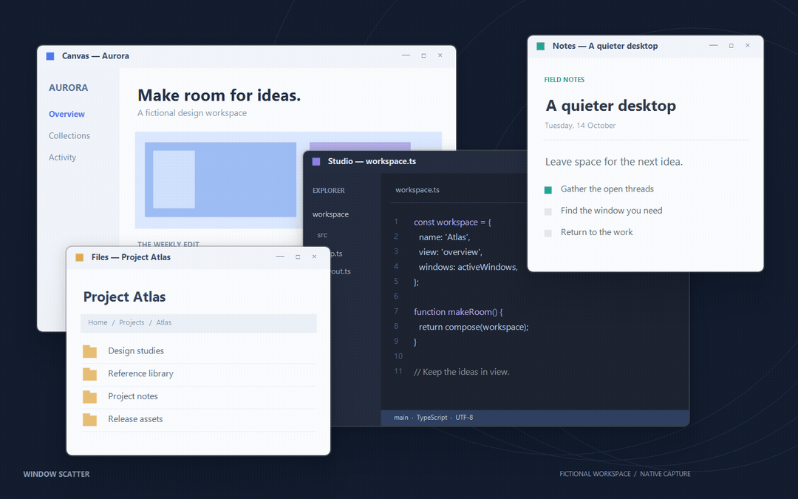

  

<h1 align="center">Window Scatter</h1>

<strong>Windows 11 的原生窗口总览</strong> 展开桌面，找到窗口，回到手头的事。

  
  
  

  <a href="https://github.com/SinCircle/windhawk-window-scatter/releases/latest/download/WindowScatter.exe"><strong>下载独立版</strong></a> ·
  <a href="#快速开始">快速开始</a> ·
  <a href="#交互细节">交互细节</a> ·
  <a href="docs/CHANGELOG.md">更新记录</a> ·
  <a href="docs/development.md">构建与开发</a>

  

展开 → 浏览 → 选择。虚构原生窗口的真实 DWM / DirectComposition 录制。<a href="docs/media/overview.png">查看静态大图</a>

Window Scatter 为 Windows 11 提供类似 Exposé 的窗口总览。按下 <kbd>Win</kbd> + <kbd>Tab</kbd>，或在触摸板上三指上滑，窗口从桌面原位缩小、散开；找到目标后点击，或继续手势选中并松手，即可切换。

<table>
<tr>
<td width="33%"><strong>保留空间感</strong> 按真实比例与原始方位排布，大窗和小窗共同适应可用区域。</td>
<td width="33%"><strong>画面持续更新</strong> 使用 DWM 实时窗口画面，由系统合成器执行动画。</td>
<td width="33%"><strong>随系统交互</strong> 支持触摸板、最小化窗口、多屏与系统强调色。</td>
</tr>
</table>

## 快速开始

**当前版本：独立版 0.5.5 / Windhawk 模组 0.4.10。** 面向 Windows 11 x64。

1. 下载 [WindowScatter.exe](https://github.com/SinCircle/windhawk-window-scatter/releases/latest/download/WindowScatter.exe)，放在准备长期使用的位置。无需安装 Windhawk、.NET 或额外运行库。
2. 第一次双击后在后台运行，不弹设置窗口，也不添加托盘图标。
3. 按 <kbd>Win</kbd> + <kbd>Tab</kbd> 打开总览；点击窗口切换，按 <kbd>Esc</kbd> 或点击背景取消。
4. 再次双击 EXE 打开设置。开机启动、系统任务视图接管、动画时长和内存模式修改后自动保存。

关闭设置面板后仍在后台运行；点击面板底部的“退出程序”即可停止运行并恢复系统入口。独立版默认动画 **666 ms**，开机启动默认关闭。

> 已使用 Windhawk 版的用户，请先停用该模组，再启动独立版。两者不能同时接管系统入口。下载文件的 SHA-256 校验值位于 [Release](https://github.com/SinCircle/windhawk-window-scatter/releases/latest) 附件。

<strong>使用 Windhawk 安装</strong>

1. 安装 [Windhawk](https://windhawk.net/)，打开“创建新模组”。
2. 将 [window-scatter.wh.cpp](window-scatter.wh.cpp) 的内容粘贴到编辑器，保存、编译并启用。
3. 在模组设置中调整动画与内存模式。Windhawk 版默认动画时长为 320 ms，已有设置不会被升级覆盖。

本项目使用 Windhawk 1.7.3 验证。两种分发形式共用窗口总览实现。

## 交互细节

### 01 · 从熟悉的位置找到窗口

所有窗口使用相同的缩放比例，保留各自的宽高比与相对大小。布局综合考虑原始位置和窗口面积：大窗更倾向于留在原来的中心附近，小窗承担更多避让；最终位置使用自由坐标求解。

窗口和下方标题一起参与间距计算。场景没有变化时，重复展开复用已有位置；出现新窗口、关闭窗口或尺寸变化时，从当前画面连续调整，尽量减少移动与交叉。关闭总览后，真实应用窗口的位置和尺寸保持原样。

### 02 · 鼠标与手势，都有完整的进出路径

| 操作 | 结果 |
| --- | --- |
| <kbd>Win</kbd> + <kbd>Tab</kbd> | 打开或关闭总览，松开按键后保持打开 |
| 三指短上滑后松手 | 打开总览，停留浏览 |
| 三指上滑后继续移动 | 按窗口所在方向选中，松手切换；支持斜向选择 |
| 总览中三指下滑 | 退出总览 |
| 点击窗口 | 切换到该窗口 |
| <kbd>Esc</kbd> / 点击背景 | 取消，回到先前窗口 |
| <kbd>Shift</kbd> + <kbd>Win</kbd> + <kbd>Tab</kbd> | 打开 Windows 原生任务视图 |

触摸板需要使用 Windows 的任务视图手势配置。短滑与继续选窗是两种不同操作；手势选中框移动时，不会移动系统鼠标指针。

### 03 · 最小化的窗口也在视线里

  

已最小化的窗口集中在各显示器底部，使用较小的独立预览，给中央工作区留出空间。底部优先按任务栏应用顺序排列，同一应用相邻。

悬停普通预览时，右上角出现 **最小化** 和 **关闭** 按钮。最小化后总览继续保持打开，窗口移到底部；选择底部窗口时，只有目标窗口恢复，并从预览位置直接放大到还原位置。取消总览不会恢复其他最小化窗口。

关闭按钮向应用发送正常关闭请求，应用仍可显示保存确认。没有可用 DWM 保留画面的最小化窗口使用共享占位图，标题和选择恢复仍然可用。

### 04 · 标题、圆角与动画作为一个整体

  

标题贴住预览下沿，保留应用名称与可用的窗口图标。选中框沿窗口和标题的完整外缘连续绘制，中间留出透明间距，颜色跟随 Windows 系统强调色。

总览统一使用 **8 DIP** 的系统样式圆角，覆盖最大化和贴靠窗口。窗口运动与标题淡入淡出各有时长；动画中再次触发或反向操作，会从当前画面接续。悬停按钮在需要时才创建，出现于动画途中时也沿用原来的时间轴。

### 05 · 每块显示器保留自己的工作区

窗口在所属显示器上分别布局，底部最小化区域也按屏幕划分。总览覆盖显示器工作区，保留真实任务栏；布局与标题按 DPI 调整，并支持位于主屏左侧或上方的负坐标屏幕。

显示器工作区或 DPI 变化时，布局重新建立。当前已在不同分辨率、不同刷新率的双屏环境下检查原生合成；四屏测试使用几何模拟，不能当作四块实体显示器的验证。

### 06 · 动画交给系统，空闲时等待事件

窗口画面通过 DWM 共享，动画一次性提交给 DirectComposition。总览本身不使用逐帧 CPU 截图或绘制循环，也不安装全局键盘钩子。窗口状态、系统主题和手势由事件驱动更新。

| 内存模式 | 取舍 |
| --- | --- |
| **自动 · 默认** | 预热并复用图形设备，内存紧张时释放图形资源 |
| **常驻** | 保留图形设备，优先再次打开的速度 |
| **省内存** | 不在启动时预热；每次退出总览后释放图形资源 |

自动与常驻模式在空闲 60 秒后回收壁纸缓存并停止任务栏读取线程，下次展开先复用排序快照，再异步刷新。三种模式都保留后台进程；释放图形资源不等于进程内存归零。

## 性能与验证

0.5.5 重点减少了大量窗口场景中的重复布局计算、标题绘制、壁纸查询与动画提交。以下为同一台机器上三次交替测试的**纯几何计算中位数**：

| 场景 | 0.5.4 | 0.5.5 |
| --- | ---: | ---: |
| 256 窗口 · 单屏 | 277.85 ms | **55.86 ms** |
| 512 窗口 · 单屏 | 1425.74 ms | **220.93 ms** |
| 512 窗口 · 四屏模拟 | 212.45 ms | **55.79 ms** |

这些时间不包含窗口枚举、DWM 画面绑定与首次显示，也不代表 FPS。32/64 位构建各通过 **39 项布局检查、76 项原生预览检查**；目前没有可靠的实际帧率增幅结论。

[查看测试方法、完整数据与边界 →](docs/performance.md)

## 兼容性与常见问题

<strong>支持哪些系统？</strong>

独立版面向 Windows 11 x64，已在内部版本 26200.9457 上验证系统入口连接与手势。其他 Windows 版本尚未逐一验证。

系统连接依赖 Windows 内部接口。已验证的系统可离线启动；其他版本首次适配时可能从微软符号服务器下载匹配符号，之后使用缓存。接口不兼容时会在设置中提示，不接管系统任务视图。

<strong>第一次双击没有窗口，是启动失败吗？</strong>

正常情况下首次启动只进入后台。再次双击同一个 EXE 会打开设置；也可以运行 `WindowScatter.exe --settings`。异常时设置页会显示说明和重新连接按钮。

<strong>设置保存在哪里？如何退出或迁移？</strong>

设置位于 `HKCU\Software\SinCircle\WindowScatter`；运行组件与符号缓存位于 `%LOCALAPPDATA%\WindowScatter`。单文件是分发形式，必要的内置连接组件在运行时释放到该目录。

在设置中点击“退出程序”，或运行 `WindowScatter.exe --exit`。开机启动仅注册当前用户启动项；启用后若移动 EXE，请在新位置关闭并重新开启该选项。

<strong>预览动图是怎样制作的？</strong>

使用六个带虚构内容的独立 Win32 窗口，由仓库中的原生预览、布局与动画代码实际渲染，再录制隔离区域。示例背景和窗口内容专为文档制作，不包含真实应用数据。动图压缩后的播放帧率仅用于展示，不作为性能测试。

录制不演示完整的系统热键或触摸板输入链路；这些交互另有实机验证。详见[素材来源与复现步骤](docs/media/README.md)。

## 开发与反馈

[构建与测试](docs/development.md) · [性能基准](docs/performance.md) · [完整更新记录](docs/CHANGELOG.md) · [报告问题](https://github.com/SinCircle/windhawk-window-scatter/issues)

反馈兼容性问题时，请附上 Windows 版本、显示器布局与缩放比例、使用的独立版或模组版本，以及复现步骤。

作者 **SinCircle**。共享窗口画面实现参考 [ADeltaX 的 DWM 接口研究](https://gist.github.com/ADeltaX/aea6aac248604d0cb7d423a61b06e247)，独立进程启动代码参考 [Ramen Software 官方示例](https://github.com/ramensoftware/windhawk/wiki/Mods-as-tools:-Running-mods-in-a-dedicated-process)。MinHook 第三方许可与构建来源见[开发文档](docs/development.md#来源与许可)。本仓库尚未指定整体许可证。
