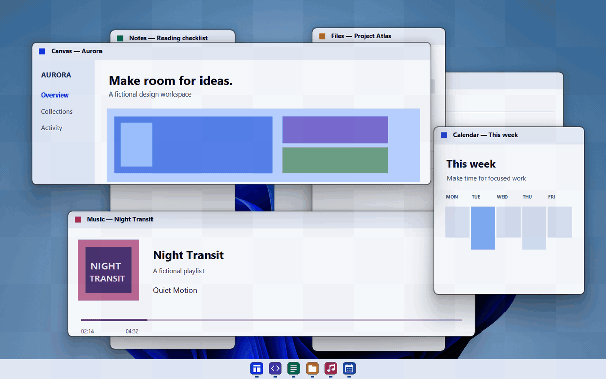
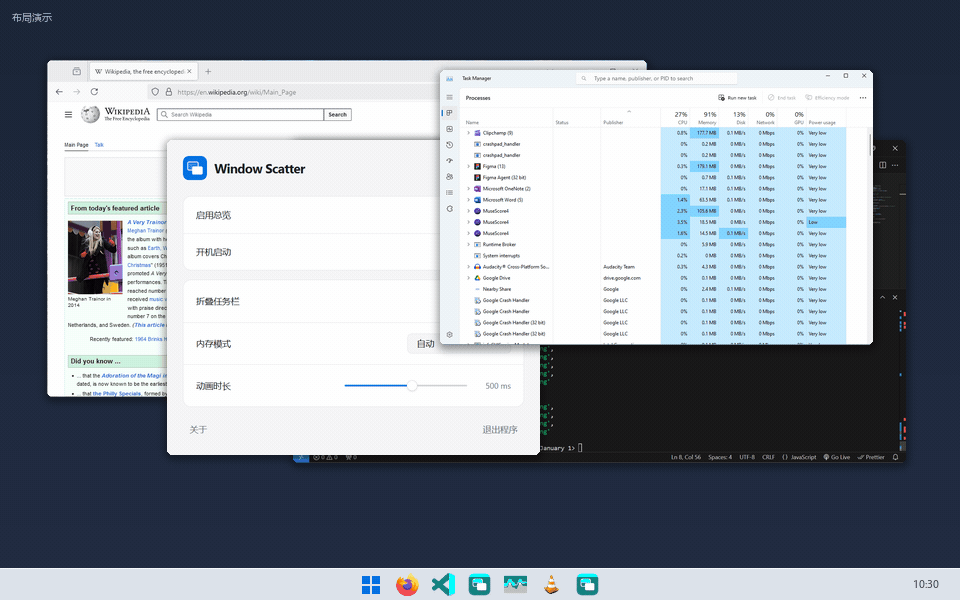
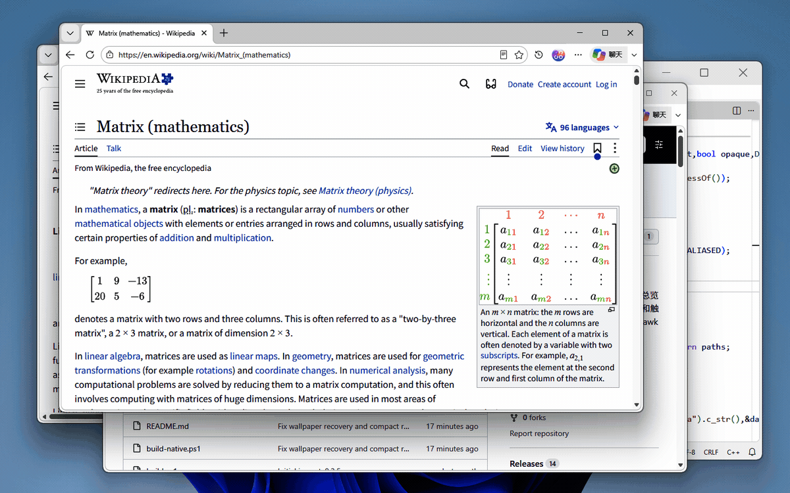
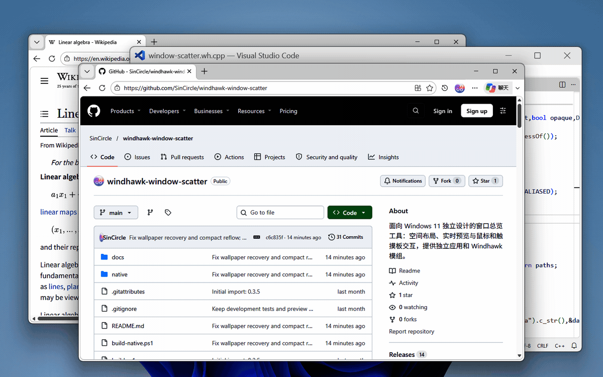
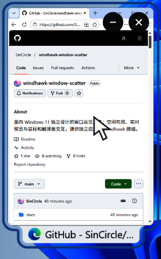
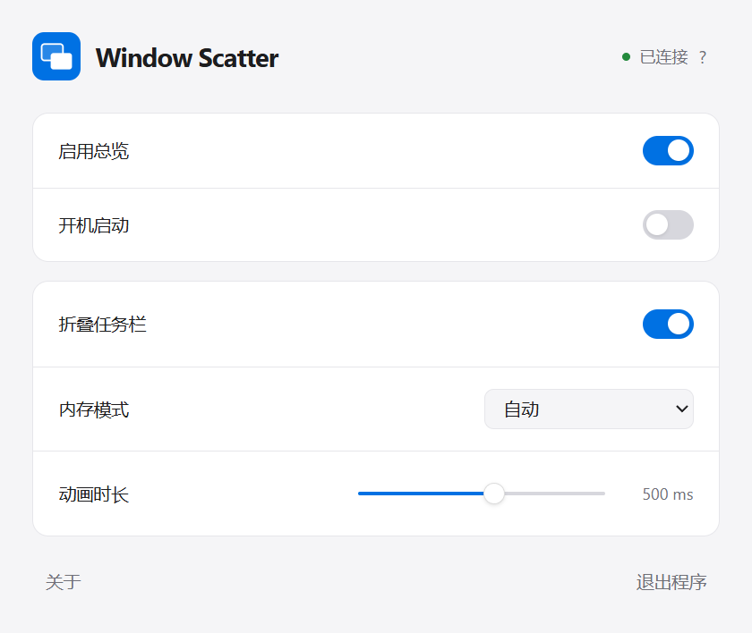

  

<h1 align="center">Window Scatter</h1>

面向 Windows 11 独立设计的窗口总览工具。

  
  

  <a href="https://github.com/SinCircle/windhawk-window-scatter/releases/latest/download/WindowScatter.exe"><strong>下载独立版</strong></a> ·
  <a href="#快速开始">快速开始</a> ·
  <a href="#功能说明">功能说明</a> ·
  <a href="docs/CHANGELOG.md">更新记录</a> ·
  <a href="docs/development.md">编译说明</a>

  

## 快速开始

将打开的窗口按原比例展开，提供实时预览、鼠标选窗和触摸板手势。支持多显示器，可使用独立应用或 Windhawk 模组。

1. 下载 [WindowScatter.exe](https://github.com/SinCircle/windhawk-window-scatter/releases/latest/download/WindowScatter.exe)，双击后直接打开设置。设置页使用 Microsoft Edge WebView2 Runtime；关闭面板后释放界面进程，窗口总览继续在后台运行。
2. 按 <kbd>Win</kbd> + <kbd>Tab</kbd> 打开总览，点击窗口预览即可切换；也可以用方向键选择后按 <kbd>Enter</kbd>。
3. 在设置中调整任务栏折叠、动画、内存模式和开机启动；鼠标移到设置行时，点击文字旁出现的「?」查看说明。再次双击 EXE 可返回设置，也可在这里退出程序。

> 使用独立版前，请先停用 Windhawk 中的同名模组。

<strong>使用 Windhawk 安装</strong>

1. 安装 [Windhawk](https://windhawk.net/)，打开“创建新模组”。
2. 将 [window-scatter.wh.cpp](window-scatter.wh.cpp) 的内容粘贴到编辑器，保存、编译并启用。
3. 在模组设置中调整任务栏折叠、动画与内存模式。

## 1.0.6 更新

修复最小化或关闭窗口后残留过大的中间间隙。Windows 聚焦壁纸的原文件失效时，改为读取对应的系统壁纸缓存，避免总览变成黑色背景。

首次打开、空闲清理和释放图形资源后重新打开，均保留设定的展开动画。

新增「折叠任务栏」设置，默认开启；关闭后，总览中的任务栏画面留在原位。独立版和 Windhawk 模组均可调整。修复切换总览时误触发系统勿扰、任务栏突然出现铃铛的问题。

批量新增、关闭窗口时合并重排，连续操作保留手势选中项。窗口改名会同步更新标题；左键拖出目标或取消捕获后松开不会误选窗口。测量范围与本机结果见[性能与验证](docs/performance.md)。

## 功能说明

### 窗口布局

相互重叠的窗口会展开为互不遮挡的预览。窗口按统一比例缩小，保留大小关系，并尽量保持原来的相对位置。横向、纵向和不同尺寸的窗口可以混合排布，预览内容实时更新。

每次打开都会按当前窗口重新计算布局。最小化、关闭或新增窗口后，其他预览会连续移动、利用空出的空间，并避免在重排中相互穿过。总览不会改变实际窗口的位置和大小。

<table>
  <tr>
    <td></td>
    <td></td>
    <td></td>
    <td></td>
  </tr>
</table>

### 鼠标、触摸板和键盘操作

| 操作 | 结果 |
| --- | --- |
| <kbd>Win</kbd> + <kbd>Tab</kbd> | 打开或关闭总览，松开按键后保持打开 |
| 点击窗口 | 切换到该窗口 |
| 中键点击窗口或标题 | 关闭该窗口 |
| <kbd>Shift</kbd> + 中键点击 | 关闭该应用分组的所有窗口，包括其他屏幕、虚拟桌面和最小化窗口 |
| 三指短上滑后松手 | 打开总览，停留浏览 |
| 三指上滑后继续移动 | 按窗口所在方向选中，松手切换；支持斜向选择 |
| 总览中三指下滑 | 退出总览 |
| <kbd>↑</kbd> <kbd>↓</kbd> <kbd>←</kbd> <kbd>→</kbd> | 按窗口所在方向移动选中框，支持跨屏 |
| <kbd>Enter</kbd> | 切换到选中窗口，最小化窗口会恢复 |
| <kbd>Esc</kbd> / 点击背景 | 取消，回到先前窗口 |
| <kbd>Shift</kbd> + <kbd>Win</kbd> + <kbd>Tab</kbd> | 打开 Windows 原生任务视图 |

触摸板的三指上滑需要在 Windows 设置中配置为“任务视图”。

左右键在普通窗口区或最小化栏内选择，上下键可在两者之间切换。方向键选中后，选中框会保持；移动鼠标后恢复悬停选择。

### 最小化与恢复

最小化的窗口显示在底部，按任务栏应用顺序排列。点击或用方向键选中后按 <kbd>Enter</kbd> 即可恢复；取消总览不会恢复这些窗口。

悬停预览时，右上角显示 **最小化** 和 **关闭** 按钮。最小化后总览保持打开，预览移到底部。关闭窗口时，应用仍可提示保存未完成的内容。

中键关闭在同一预览内松开时生效，拖到其他窗口或背景会取消。Shift＋中键按应用身份分组，支持同一应用的不同进程；不会强制结束进程，取消关闭的窗口仍保留在总览中。

### 标题、选中框和动画

  

标题显示在预览下方，选中框颜色跟随 Windows 主题色。所有预览使用统一圆角。

动画时长可在设置中调整，设为 0 可关闭动画。动画未结束时再次操作，会从当前画面继续展开或收回。

连续操作会在布局与画面准备完成后，按合成器的交接时刻重新采样位置、圆角、标题和任务栏，减少倒退或停顿。退出阴影直接对互不重叠的边缘应用透明度，减少合成开销；重新展开完成后移除不可见阴影图层，保留可复用资源。测量范围和分阶段数据见[性能与验证](docs/performance.md)。

### 任务栏折叠

  

「折叠任务栏」默认开启：进入总览时沿屏幕边缘收起，退出时恢复；关闭后，任务栏画面保持原位。设置即时保存，不改变 Windows 的任务栏自动隐藏配置。独立版在设置面板中调整，Windhawk 版在模组设置中调整。

最小化窗口仍从对应任务栏按钮的位置与宽高飞出，再连续变成窗口预览的比例。

### 多显示器

各屏幕上的窗口分别排列，任务栏遵循同一个折叠设置。支持不同分辨率、缩放比例和显示器位置。

### 内存模式

| 内存模式 | 说明 |
| --- | --- |
| **自动 · 默认** | 缓存绘图资源以便快速打开，内存不足时释放 |
| **常驻** | 保留绘图资源，优先打开速度 |
| **省内存** | 关闭总览后释放绘图资源，下次打开重新加载 |

## 设计与参考

macOS 和 Linux 桌面的多任务总览界面是本项目的交互参考。Window Scatter 根据自身的设计目标，独立探索窗口的空间布局、手势选窗、连续重排与最小化恢复，让窗口管理适应 Windows 上的实际使用方式。

## 更多说明

[常见问题](docs/usage.md) · [性能测试](docs/performance.md) · [编译说明](docs/development.md) · [预览素材说明](docs/media-sources.md) · [更新记录](docs/CHANGELOG.md) · [反馈问题](https://github.com/SinCircle/windhawk-window-scatter/issues)

作者 **SinCircle** · [来源与许可](docs/development.md#来源与许可)
